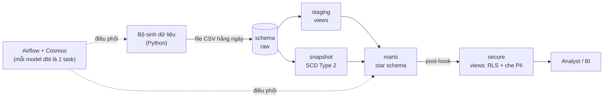
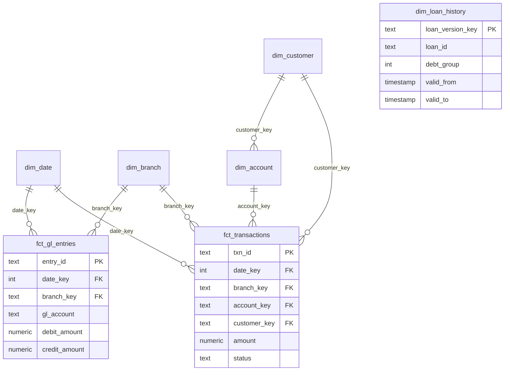
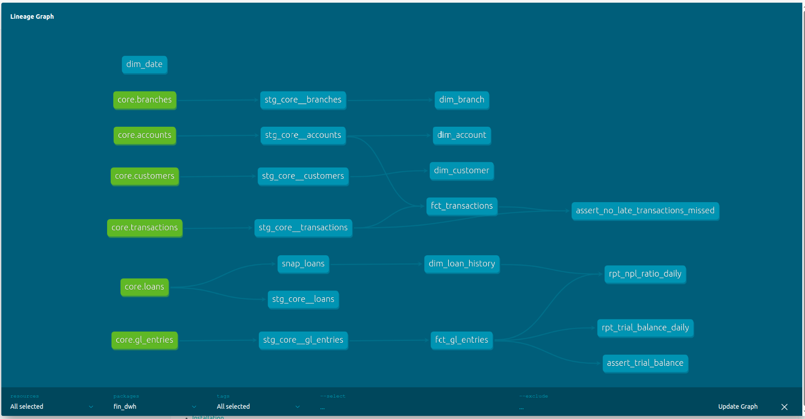
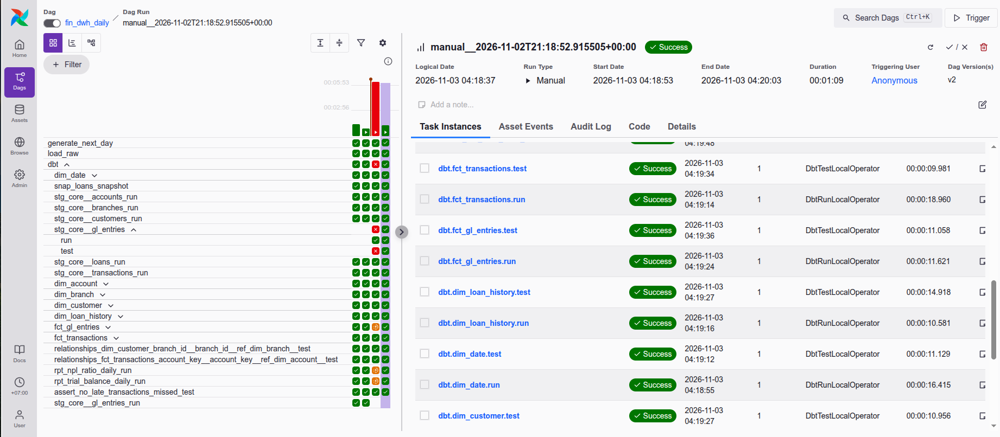
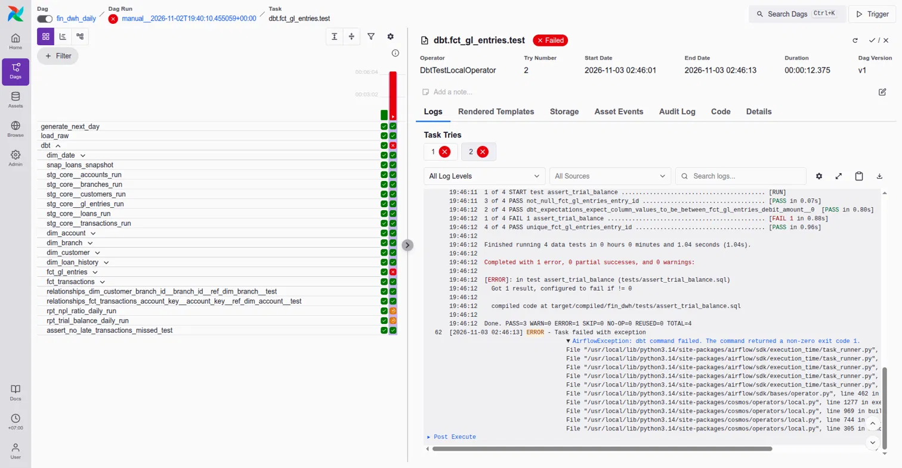
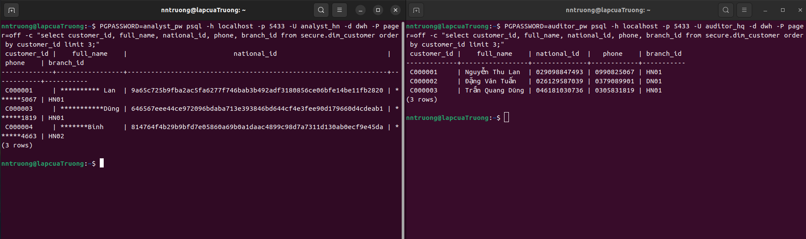

# Banking Data Warehouse


Kho dữ liệu batch cho một ngân hàng bán lẻ giả lập, xây bằng **dbt**, **Airflow 3 + Astronomer Cosmos** và **PostgreSQL**, chạy hoàn toàn trên Docker.
Dự án xử lý ba bài toán có thật trong dữ liệu ngân hàng: giao dịch liên ngân hàng về trễ và đổi trạng thái, khoản vay chuyển nhóm nợ theo thời gian, và sổ cái phải luôn cân Nợ = Có.

**Công nghệ:** PostgreSQL 16 · dbt Core 1.12 · dbt_expectations · Apache Airflow 3 · Astronomer Cosmos · Docker / Astro CLI · SQLFluff · GitHub Actions

## Kiến trúc



## Mô hình dữ liệu



| Bảng | Grain (mỗi dòng là) | Cách nạp |
| --- | --- | --- |
| `fct_transactions` | một giao dịch, trạng thái mới nhất | incremental merge theo `txn_id` |
| `fct_gl_entries` | một dòng Nợ hoặc Có của bút toán | incremental merge theo `entry_id` |
| `dim_date` | một ngày lịch (2020–2030) | table |
| `dim_branch`, `dim_customer`, `dim_account` | một chi nhánh / khách hàng / tài khoản | table |
| `dim_loan_history` | một phiên bản của khoản vay (SCD Type 2) | từ snapshot |
| `rpt_trial_balance_daily` | ngày hạch toán × chi nhánh × loại tiền | table |
| `rpt_npl_ratio_daily` | ngày × chi nhánh, tỷ lệ nợ xấu (NPL) tại ngày đó; chỉ công bố ngày đủ lịch sử | table |

## Dự án làm được gì

| Tính năng | Cách làm | Ở đâu |
| --- | --- | --- |
| Kimball star schema | 2 bảng fact (giao dịch, bút toán sổ cái) và 5 dimension dùng surrogate key | `dags/dbt/fin_dwh/models/marts/` |
| Dữ liệu về trễ | Incremental `merge` lấy những giao dịch có sự kiện mới mà warehouse nhận kể từ lần chạy trước (mốc `_loaded_at` do DB gán lúc nạp), chứ không theo ngày giao dịch: giao dịch liên ngân hàng về trễ bao nhiêu ngày vẫn được chèn, `PENDING → SETTLED/REVERSED` luôn được cập nhật, và chỉ các giao dịch đó được xếp hạng lại. Test đối soát báo cả giao dịch thiếu lẫn sai trạng thái | `models/marts/fct_transactions.sql`, `tests/assert_no_late_transactions_missed.sql` |
| Lịch sử nhóm nợ | dbt snapshot (SCD Type 2, strategy `timestamp`) giữ mọi lần khoản vay đổi nhóm nợ (nhóm 1–5, nợ xấu = nhóm 3–5) | `snapshots/snap_loans.yml`, `models/marts/dim_loan_history.sql` |
| Chất lượng dữ liệu | 29 test: test có sẵn của dbt, `dbt_expectations` (regex, khoảng giá trị, tập giá trị) và test SQL tự viết (đối soát nguồn ↔ fact cho giao dịch và sổ cái, kiểm chứng point-in-time của nợ xấu), chạy ngay trong database | `models/marts/_marts.yml`, `tests/` |
| Circuit breaker | Kiểm tra ngay ở staging: nếu Nợ ≠ Có ở bất kỳ ngày hạch toán × chi nhánh × loại tiền nào, test fail, bảng fact sổ cái và các báo cáo phía sau bị bỏ qua, giữ nguyên số của lần chạy đúng gần nhất, nên không có số sai nào đến tay người dùng. Khi bút toán còn thiếu về, sổ cân lại và pipeline tự chạy tiếp | `tests/assert_trial_balance.sql` |
| Bảo mật theo dòng (RLS) | Macro post-hook đọc `meta.rls_branch_column` trong YAML và tạo policy RLS của PostgreSQL: mỗi analyst chỉ thấy chi nhánh của mình | `macros/governance/apply_governance.sql` |
| Che dữ liệu cá nhân (PII) | Cột gắn `meta: {pii: true}` được che trong các view `secure.*` (HMAC-SHA256 với khóa bí mật, che một phần hoặc ẩn hẳn); chỉ `pii_reader` thấy giá trị thật. Giá trị HMAC được pipeline băm sẵn lúc build; người đọc không có quyền gọi hàm băm | cùng macro trên, `warehouse/init/01_init.sql` |
| Điều phối | DAG Airflow chạy hằng ngày; Cosmos biến mỗi model dbt thành một task và chạy test ngay sau model đó, có retry | `dags/fin_dwh_daily.py` |
| Độ mới của nguồn | `dbt source freshness` trên giao dịch và sổ cái, đo theo `_loaded_at` (giờ thật lúc warehouse nhận dữ liệu): cảnh báo sau 30 giờ, lỗi sau 54 giờ không có dữ liệu mới | `models/staging/_sources.yml` |
| CI | Mỗi lần push / mở PR: dựng Postgres mới, sinh dữ liệu giả lập, kiểm tra source freshness, lint bằng SQLFluff, chạy toàn bộ `dbt build` | `.github/workflows/ci.yml` |

## Ảnh chụp màn hình

| | |
| --- | --- |
|  Sơ đồ lineage của dbt |  Airflow: mỗi model dbt là một task |
|  Sổ cái lệch: test fail, báo cáo bị bỏ qua |  Cùng một câu truy vấn, hai user: lọc theo chi nhánh và che PII |

## Hiệu năng: incremental so với full refresh

Đo với 60 ngày dữ liệu ở `--scale 10`: 2,49 triệu sự kiện giao dịch và 4,34 triệu dòng sổ cái trong raw (PostgreSQL 16 trên Docker, laptop cá nhân). Mỗi lần incremental là sau khi nạp thêm 1 ngày.

| Lần chạy | `fct_transactions` | `fct_gl_entries` |
| --- | --- | --- |
| Full refresh | 1.819.422 dòng, 20,7 s | 4.405.122 dòng, 20,2 s |
| Incremental, ngày thứ 61 | merge 39.933 dòng, 3,0 s | merge 65.974 dòng, 2,7 s |
| Incremental, ngày thứ 62 | merge 43.062 dòng, 2,2 s | merge 76.874 dòng, 2,7 s |

Incremental nhanh hơn khoảng 7–9 lần, và vẫn giữ mức đó khi lịch sử dài thêm. Kế hoạch truy vấn (`EXPLAIN ANALYZE`) xác nhận lần incremental chỉ đọc khoảng 60 nghìn sự kiện của các giao dịch vừa thay đổi, qua index `raw.transactions (txn_id)`, chứ không xếp hạng lại 2,5 triệu sự kiện; phần truy vấn mất 0,49 s, còn lại là thời gian `merge`. Dữ liệu ngày thứ 61 gồm cả giao dịch mới lẫn các giao dịch cũ vừa quyết toán hoặc về trễ.

Tự đo lại: `python include/data_generator/bankgen.py init --days 60 --scale 10 --force`, rồi `load` và `dbt build` (mất khoảng 1,5 phút).

## Chạy nhanh

Yêu cầu: Ubuntu (hoặc WSL2), Docker, Python 3.10+, còn trống khoảng 4 GB RAM cho Airflow.

```bash
# 0. Biến môi trường (file .env thật không nằm trong repo)
cp .env.example .env
cp dags/dbt/fin_dwh/.env.example dags/dbt/fin_dwh/.env

# 1. Warehouse
docker compose -f docker-compose.override.yml up -d

# 2. Công cụ
python3 -m venv .venv && source .venv/bin/activate
pip install -r requirements-dev.txt

# 3. Dữ liệu giả lập (30 ngày)
python include/data_generator/bankgen.py init --days 30
python include/data_generator/bankgen.py load

# 4. dbt
cd dags/dbt/fin_dwh
dbt deps && dbt build

# 5. Airflow (không bắt buộc; tắt warehouse ở bước 1 trước)
cd ../../.. && docker compose -f docker-compose.override.yml down
astro dev start          # giao diện tại http://localhost:8080
```

Tài khoản demo (đổi khi dùng thật): `dbt_runner / dbt_runner_pw`, `analyst_hn`, `analyst_hcm / analyst_pw`, `auditor_hq / auditor_pw`.

Thử lớp bảo mật:

```bash
PGPASSWORD=analyst_pw psql -h localhost -p 5433 -U analyst_hn -d dwh \
  -c "select branch_id, count(*) from secure.fct_transactions group by 1;"   # chỉ thấy HN01, HN02
```

Giả lập ngày làm việc tiếp theo, hoặc cố tình làm lệch sổ cái để xem circuit breaker hoạt động:

```bash
python include/data_generator/bankgen.py next-day                      # sinh thêm 1 ngày dữ liệu
python include/data_generator/bankgen.py next-day --inject-imbalance   # giữ lại một dòng Có
python include/data_generator/bankgen.py load
cd dags/dbt/fin_dwh && dbt build    # khi sổ lệch: FAIL assert_trial_balance, fct_gl_entries và báo cáo SKIP
```

Lần `next-day` kế tiếp, dòng Có bị giữ lại sẽ về như một bút toán bổ sung (giữ ngày hạch toán cũ), sổ cái cân trở lại và `dbt build` chạy xanh.

Trong Airflow, trigger DAG `fin_dwh_daily` với tham số `inject_imbalance` để thấy điều tương tự trên giao diện.

## Cấu trúc thư mục

```
.
├── dags/
│   ├── fin_dwh_daily.py            # DAG Airflow (Cosmos)
│   └── dbt/fin_dwh/                # dự án dbt
│       ├── models/staging/         # 6 view: làm sạch, lấy trạng thái mới nhất của mỗi giao dịch
│       ├── models/marts/           # star schema + báo cáo + test YAML và meta quản trị dữ liệu
│       ├── snapshots/              # SCD Type 2 cho khoản vay
│       ├── macros/governance/      # post-hook RLS + che PII
│       └── tests/                  # circuit breaker, đối soát nguồn ↔ fact, point-in-time nợ xấu
├── include/data_generator/         # sinh dữ liệu core-banking giả lập + nạp vào raw
├── warehouse/init/01_init.sql      # role, schema, hàm HMAC, bảng phân quyền chi nhánh
├── .github/workflows/ci.yml        # CI
├── Dockerfile                      # Astro Runtime + dbt trong virtualenv riêng
├── docker-compose.override.yml     # warehouse Postgres
└── .env.example                    # mẫu biến môi trường (cp thành .env)
```

## Quyết định thiết kế

- **Dữ liệu giả lập.** Ngân hàng không công bố dữ liệu giao dịch. Bộ sinh dữ liệu cố tình tạo ra các tình huống khó: khoảng 25% giao dịch liên ngân hàng về trễ 1–5 ngày, trạng thái thay đổi sau khi đã nạp, giao dịch bị trả về (REVERSED) có bút toán đảo, khoảng 1% khoản vay đổi nhóm nợ mỗi ngày, và có cờ để cố tình làm lệch sổ cái.
- **Mốc incremental do warehouse gán, không lấy từ dữ liệu nguồn.** Bảng raw có cột `_loaded_at` (`default now()` của Postgres lúc nạp), và cả hai bảng fact chỉ lấy những gì warehouse nhận sau mốc của lần chạy trước. Mình đã thử hai cách khác và cả hai đều sai:
  - lọc theo ngày giao dịch: giao dịch phát sinh từ 4 ngày trước mà hôm nay mới quyết toán sẽ kẹt mãi ở `PENDING`;
  - lọc theo `ingested_at` của nguồn: một bút toán điều chỉnh nhập tay với `now()` (giờ thật, trong khi dữ liệu giả lập ở quá khứ) đẩy mốc lên tương lai, bảng fact sổ cái ngừng nhận bút toán mới mà sổ vẫn cân, không test nào báo.
  
  Với giao dịch, bảng chỉ xếp hạng lại các `txn_id` vừa có sự kiện mới: điều kiện viết dạng `txn_id = any(array(...))` để Postgres đẩy nó xuống trước window function của staging và dùng index, nên lần chạy incremental tốn công theo lượng dữ liệu mới chứ không theo kích thước lịch sử. Test đối soát staging ↔ fact (giao dịch: mức `warn`; sổ cái: mức `error`) bắt những gì còn lọt.
- **Source freshness theo giờ thật.** Cùng cột `_loaded_at`: dữ liệu giả lập ở quá khứ, nên đo độ mới theo `ingested_at` của nguồn thì lúc nào cũng báo lỗi.
- **Mức độ nghiêm trọng của test.** `error` cho mọi thứ làm sai số liệu (sổ cái lệch, trùng khóa, khóa ngoại hỏng); `warn` cho những việc cần theo dõi mà không phải dừng pipeline.
- **Quản trị dữ liệu bằng metadata.** Quy tắc bảo mật nằm ngay cạnh định nghĩa cột trong YAML, nên muốn bảo vệ bảng mới chỉ cần thêm `meta`, và người review nhìn là biết cột nào chứa PII.
- **HMAC thay vì SHA-256 thường, và băm sẵn.** Số CCCD 12 chữ số có thể dò ngược từ hash thường; HMAC thì cần khóa bí mật. Người đọc cũng không được gọi hàm băm: nếu gọi được, họ chỉ cần đoán một số CCCD rồi băm thử là biết đúng hay sai. Vì vậy pipeline băm sẵn lúc build và view chỉ đọc kết quả.
- **Chặn số sai ở cửa vào.** Test cân đối sổ cái đặt trên staging chứ không trên bảng fact: nếu đặt trên fact, bảng fact và view `secure.*` của nó đã kịp nhận số sai trước khi test chạy.
- **Kiểm chứng point-in-time của nợ xấu.** Báo cáo as-of từ SCD2 dễ sai ở hai chỗ: lịch sử bị hổng (snapshot chỉ ghi từ lần chạy đầu, khoản vay đổi nhóm trước đó "vắng mặt" ở các ngày cũ) và báo cáo tụt lại sau nguồn. Khi kiểm tra, ngày đầu kỳ chỉ đếm được 632/800 khoản vay, và vì nợ chủ yếu chuyển xấu đi nên tỷ lệ NPL bị thấp hơn thực tế. Cách xử lý: báo cáo chỉ công bố ngày mà mọi khoản vay đã giải ngân đều có đúng một phiên bản hiệu lực; test `assert_npl_point_in_time` đối chiếu với `raw.loans` (không qua snapshot, để không tự xác nhận chính logic cần kiểm tra): mỗi ngày đủ số khoản vay, ngày cuối khớp từng chi nhánh với trạng thái hiện tại, và báo cáo không dừng ở ngày cũ hơn lần đổi nhóm nợ mới nhất.
- **Quyền tối thiểu.** Pipeline chạy bằng user không phải superuser, vì superuser bỏ qua được RLS.

## Hạn chế và hướng phát triển

- Dữ liệu do chính bộ sinh của dự án tạo ra, nên các tình huống khó (về trễ, đổi trạng thái, đổi nhóm nợ) là những tình huống mình đã biết trước; dữ liệu thật sẽ có những kiểu lỗi chưa lường được. Bù lại, các test đối soát và point-in-time so với dữ liệu nguồn chứ không so với giả định của bộ sinh, và chính chúng đã tìm ra hai lỗi không do bộ sinh cố ý tạo (bảng fact sổ cái ngừng nạp, báo cáo nợ xấu thiếu khoản vay).
- Khóa HMAC đang lưu trong một bảng cho mục đích demo; khi chạy thật sẽ lấy từ secret manager.
- PostgreSQL không có dynamic masking sẵn, nên việc che dữ liệu làm bằng view. Trên Snowflake hoặc BigQuery, cùng macro này sẽ sinh ra masking policy và row access policy.
- Snapshot chỉ ghi lịch sử từ lần chạy đầu tiên; trạng thái khoản vay trước đó không được dựng lại, nên báo cáo nợ xấu chỉ bắt đầu từ ngày đó.
- Chưa làm Slim CI (`state:modified+ --defer`): CI dựng warehouse trống mỗi lần nên không có môi trường production để `--defer` tới, và build toàn bộ chỉ mất khoảng 1 phút. Slim CI chỉ đáng làm khi có warehouse production chạy thật.
- Tiếp theo: dashboard BI trên `secure.*`; partition bảng raw theo ngày nạp khi dữ liệu lên hàng chục triệu dòng.

## Tác giả

**NGUYEN NGOC TRUONG** · nntruong291s@gmail.com

Toàn bộ dữ liệu trong repo này là giả lập; không dùng dữ liệu khách hàng thật.
